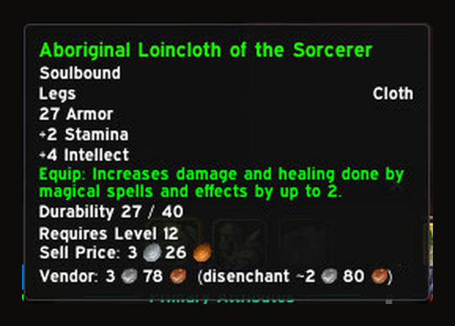
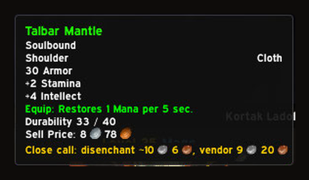

# DustOrGold

A WoW Forever addon that tells you whether an item is worth more sold to a vendor or disenchanted.

Made mainly for me and my friends. It's shared in case it's useful to others too, but expect it to follow our needs first. Questions and bugs: [GitHub issues](https://github.com/RobinLanderloos/DustOrGold/issues).

- **Tooltip:** a verdict (vendor, disenchant or close call) with the vendor price and the expected disenchant value after the auction cut. Hold Shift for the materials and their odds. When Auctionator knows the item's own price, a line shows what listing it would fetch.
- **List window** (`/dog` or the minimap button): your bag items grouped into vendor, disenchant, auction, close calls and no price data, with totals and a one-click Disenchant button for enchanters.
- **Results log:** every disenchant is recorded. Right after it, a chat line shows what the materials are worth at current prices and how that compares with the expected value (`/dog results off` hides it). `/dog results` compares what you got with the table and gives the running total.

If [Auctionator](https://www.curseforge.com/wow/addons/auctionator) is installed, DustOrGold uses its prices and does no scanning of its own. Without Auctionator, DustOrGold scans the auction house itself: materials are searched whenever you open the auction house, and `/dog scan` also runs a full scan. `/dog help` lists all commands.

## Screenshots





## Development

The calculation lives in `Core/` and makes no game calls, so it is tested outside the game with LuaJIT:

```
luajit tests/run.lua         # unit tests
luajit tests/smoke_test.lua  # loads every file in the .toc against a stand-in for the game
```

Releases: set `## Version:` in `DustOrGold.toc`, run `pwsh scripts/package.ps1`, and attach `dist/DustOrGold-<version>.zip` and `dist/release.json` to a GitHub release tagged `v<version>` (mark it a pre-release for betas). WowUp Hub picks releases up from there.

Design decisions are in `docs/adr/`, the product requirements in `docs/prd/`, and the work items in `docs/issues/`.

## License

MIT, see [LICENSE](LICENSE).
